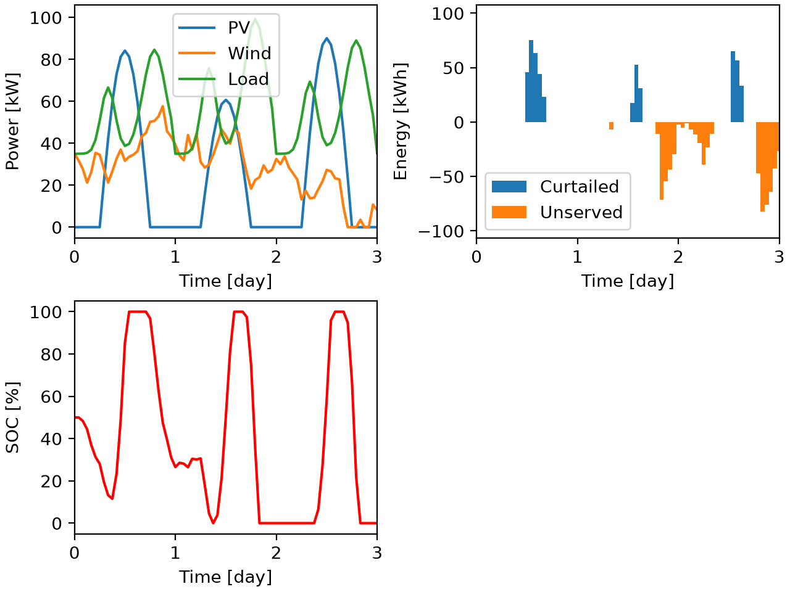
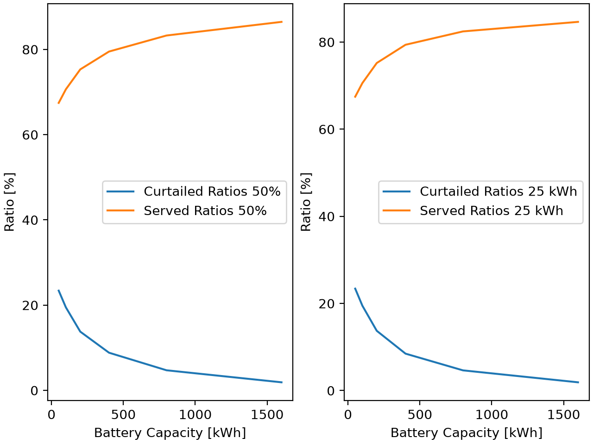
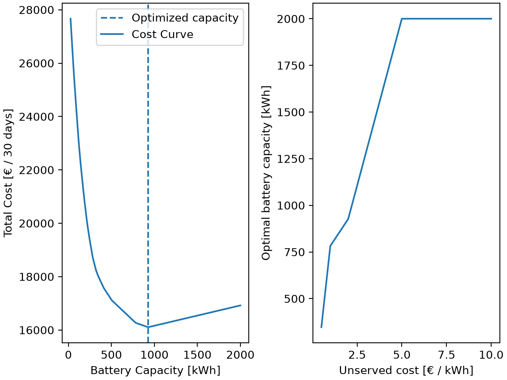

# Simulation and Capacity Optimization of a Renewable Microgrid

## Overview

This project presents a time-discrete Python simulation of a simplified renewable microgrid consisting of photovoltaic (PV) generation, wind generation, an electrical load, and a battery energy storage system.

The objective is to investigate the influence of battery capacity on supply reliability and renewable energy curtailment, and to determine an economically favorable storage capacity under simplified cost assumptions.

The model uses synthetic generation and demand profiles over a **30-day simulation period with hourly resolution**.

### Key Features

- **Renewable generation:** Synthetic PV and stochastic wind power profiles.
- **Electricity demand:** Time-dependent load profile with morning and evening demand peaks.
- **Battery storage:** Time-discrete energy balance incorporating charging and discharging efficiencies and storage capacity constraints.
- **Model verification:** Numerical verification of the energy balance at each simulation time step.
- **Parameter study:** Investigation of battery capacity effects on energy supply reliability and renewable energy curtailment.
- **Economic optimization:** Minimization of battery capacity costs and costs associated with unserved energy using `scipy.optimize.minimize_scalar`.
- **Sensitivity analysis:** Investigation of how the assumed cost of unserved energy influences the economically optimal battery capacity.

## Model Description

The microgrid consists of four main components:

| Component | Description |
|---|---|
| Photovoltaic generation | Simplified daily generation profile with randomized daily weather conditions; rated power of 100 kW |
| Wind generation | Stochastic mean-reverting power model with a rated power of 70 kW |
| Electrical load | Constant base load of 35 kW combined with Gaussian-shaped morning and evening demand peaks |
| Battery storage | Energy storage with a charging and discharging efficiency of 95%, subject to capacity constraints |

The system is simulated with a fixed time step of **1 hour**.

At each time step, the difference between renewable generation and electricity demand determines whether the battery is charged or discharged.

When renewable generation exceeds demand and the battery is fully charged, the remaining energy is curtailed. When demand exceeds generation and the battery is depleted, the remaining demand is classified as unserved energy.

The model assumes an islanded microgrid without an external electricity grid connection.

## Mathematical Formulation

### 1. Net Power Balance

At each time step, the net power available to the battery is calculated as:

```math
P_{\mathrm{net},i} = P_{\mathrm{PV},i} + P_{\mathrm{wind},i} - P_{\mathrm{load},i}
```

A positive net power indicates an energy surplus, while a negative value indicates an energy deficit.

The simulation uses a fixed time step of $\Delta t = 1\,\mathrm{h}$.

### 2. Battery Energy Storage Model

The battery is modeled using a discrete energy balance with charging and discharging efficiencies.

The stored energy is constrained by:

```math
0 \leq E_i \leq C
```

where $E_i$ is the stored battery energy at time step $i$ and $C$ is the installed battery capacity.

A constant efficiency of $\eta = 0.95$ is assumed for both charging and discharging.

**Charging ($P_{\mathrm{net},i} \geq 0$)**

When generation exceeds demand, the battery is charged according to:

```math
E_{i+1} = \min\left(C, E_i + \eta P_{\mathrm{net},i}\Delta t\right)
```

If the battery reaches its maximum capacity, the remaining energy is curtailed:

```math
E_{\mathrm{curtailed},i} = \max\left(0, P_{\mathrm{net},i}\Delta t - \frac{C-E_i}{\eta}\right)
```

**Discharging ($P_{\mathrm{net},i} < 0$)**

When demand exceeds generation, the battery is discharged:

```math
E_{i+1} = \max\left(0, E_i + \frac{P_{\mathrm{net},i}\Delta t}{\eta}\right)
```

If the battery cannot cover the entire energy deficit, the remaining demand is classified as unserved energy:

```math
E_{\mathrm{unserved},i} = \max\left(0, -P_{\mathrm{net},i}\Delta t - \eta E_i\right)
```

### 3. Energy Balance Verification

The numerical implementation is verified by checking the energy balance at every simulation time step:

```math
E_{\mathrm{generation},i} + E_{\mathrm{unserved},i} = E_{\mathrm{load},i} + E_{\mathrm{curtailed},i} + E_{\mathrm{loss},i} + \Delta E_{\mathrm{battery},i}
```

Here,

```math
\Delta E_{\mathrm{battery},i} = E_{i+1} - E_i
```

represents the change in stored battery energy.

The energy losses are calculated independently from the change in stored energy:

```math
E_{\mathrm{loss},i} =
\begin{cases}
\Delta E_{\mathrm{battery},i}\left(\frac{1}{\eta}-1\right), & \Delta E_{\mathrm{battery},i}>0 \\[6pt]
\Delta E_{\mathrm{battery},i}(\eta-1), & \Delta E_{\mathrm{battery},i}\leq0
\end{cases}
```

The residual of the energy balance is evaluated numerically at each time step using numpy.allclose with an absolute tolerance of $10^{-10},\mathrm{kWh}$ and zero relative tolerance.

The verification is performed for the reference simulation and for all battery capacities considered in the parameter study.

## Results and Discussion

### 1. System Simulation



**Figure 1:** Simulated photovoltaic and wind generation, electrical demand, battery state of charge (SOC), curtailed energy, and unserved energy over the first three days.

The simulation demonstrates the interaction between fluctuating renewable generation, electricity demand, and battery storage.

During periods of excess generation, the battery absorbs surplus energy until its maximum capacity is reached. Additional surplus energy is curtailed.

During periods of insufficient generation, the battery supplies stored energy to compensate for the deficit. Once the battery is depleted, the remaining demand cannot be served.

The battery therefore reduces both renewable energy curtailment and supply shortages, although its effectiveness is limited by the available storage capacity.

### 2. Battery Capacity Study



**Figure 2:** Influence of battery capacity on the fraction of curtailed renewable energy and the fraction of electrical demand served.

Battery capacities ranging from 50 to 1600 kWh were investigated under two different initial conditions:

- **Initial SOC of 50%:** The initial stored energy increases proportionally with battery capacity.
- **Constant initial energy of 25 kWh:** All battery configurations start with the same amount of stored energy.

Increasing battery capacity generally improves supply reliability and reduces renewable energy curtailment.

However, the improvement becomes progressively smaller as storage capacity increases.

The comparison also illustrates the influence of initial conditions. When the initial SOC is fixed at 50%, larger batteries benefit from a greater amount of initially stored energy.

For the subsequent economic optimization, a constant initial energy of 25 kWh is used to ensure that all battery configurations are compared under identical initial energy conditions.

### 3. Economic Capacity Optimization



**Figure 3:** Total system cost as a function of battery capacity and sensitivity of the optimal capacity to the assumed cost of unserved energy.

An illustrative economic optimization was performed to identify the battery capacity that minimizes the combined costs of installed storage capacity and unserved energy.

The objective function is defined as:

```math
J(C) = c_{\mathrm{battery}} C + c_{\mathrm{unserved}} E_{\mathrm{unserved,tot}}(C)
```

where:

- $C$ is the installed battery capacity [kWh].
- $c_{\mathrm{battery}}$ is the annualized battery investment cost allocated to the 30-day simulation period [€/kWh].
- $c_{\mathrm{unserved}}$ is the assumed cost of unserved energy [€/kWh].
- $E_{\mathrm{unserved,tot}}(C)$ is the total unserved energy over the simulation period [kWh].

Battery investment costs are annualized using an assumed lifetime of 10 years and a discount rate of 5%.

The optimization is performed using `scipy.optimize.minimize_scalar` within a battery capacity range of 25–2000 kWh.

For an assumed unserved energy cost of **2 €/kWh**, the resulting optimal battery capacity is approximately **927 kWh**.

The sensitivity analysis shows that higher costs of unserved energy favor larger battery capacities, while lower costs favor smaller capacities.

For unserved energy costs of 5 €/kWh and 10 €/kWh, the optimizer reaches the upper capacity bound of 2000 kWh. These results therefore represent constrained optima within the investigated range rather than unconstrained optimal capacities.

The numerical optimization results were additionally compared with a discrete grid search to check their plausibility.

The results illustrate the trade-off between investment costs and supply reliability: increasing battery capacity reduces energy shortages but also increases storage costs. The economically favorable capacity depends on the assumed cost parameters and operating conditions.
